  

  
  
  
  
  
  

# 🚀 Awesome Collaborative Work Management (CWM)

> **A definitive, SEO-optimized curated directory of enterprise SaaS Work OS suites, agile visual task orchestrators, and sovereign open-source collaborative work management software.**

Collaborative Work Management (CWM) software empowers modern knowledge workers, engineering squads, and cross-functional teams to coordinate complex initiatives, automate multi-step workflows, visualize sprint pipelines, and align operational tasks with strategic enterprise objectives. This repository tracks market-leading SaaS solutions alongside sovereign self-hosted open-source alternatives.

---

## 📑 Table of Contents

- [📊 Sector Overview & Market Dynamics](#-sector-overview--market-dynamics)
- [🏢 SaaS & Cloud Work Management Platforms](#-saas--cloud-work-management-platforms)
- [🔓 Open-Source GitHub Projects](#-open-source-github-projects)
- [🛠️ Recommended Framework Combinations](#️-recommended-framework-combinations)
- [🤝 How to Contribute](#-how-to-contribute)
- [📈 Star History](#-star-history)
- [💖 Support & Sponsoring](#-support--sponsoring)
- [📜 Disclaimer](#-disclaimer)

---

## 📊 Sector Overview & Market Dynamics

The global **Collaborative Work Management (CWM)** market is valued at approximately **$8.5 billion in 2024–2025** and is projected to expand to over **$22.5 billion by 2030**, advancing at a robust compound annual growth rate (**CAGR of 13.8%**). 

The sector exhibits **moderate fragmentation**: while multi-billion-dollar enterprise platforms (such as ServiceNow, Atlassian, Monday.com, and Asana) dominate broad corporate deployments and portfolio rollups, extreme diversity in team workflows (product, engineering, creative, marketing, and operations) prevents a "winner-take-all" monopoly. Consequently, flexible no-code work engines (Airtable, Notion) and sovereign, self-hosted open-source ecosystems (AppFlowy, Plane, NocoDB) continue to capture significant market share among teams prioritizing data privacy, customization, and cost efficiency.

---

## 🏢 SaaS & Cloud Work Management Platforms

The following table benchmarks category-leading SaaS Collaborative Work Management platforms. It is sorted in descending order by **Company Scale (Market Capitalization / Valuation / Revenue)**.

| 🏷️ Product | 💼 Company Scale | 💵 Starting Tier Pricing | 🎁 Free Tier / Trial Limits | 🔍 Core Capabilities & Best For |
|:---|:---|:---|:---|:---|
| **[ServiceNow CWM](https://www.servicenow.com/)** | **~$175.0B Market Cap** *(~$10.9B FY24 Rev)* | **$100.00/user/mo** *(Enterprise SPM / ITSM licensing)* | **14-day Personal Developer Instance (PDI)** with full platform access (renews with activity) or **30-day enterprise evaluation trial** | Enterprise-grade work orchestration connecting ITSM, strategic planning, Agile Sprint backlog management, and live ServiceNow collaborative documents. |
| **[Trello](https://trello.com/)** *(Atlassian)* | **~$45.0B Market Cap** *(Atlassian, ~$4.3B FY24 Rev)* | **$5.00/user/mo** *(Standard, billed annually; $6/mo monthly)* | **Free forever for unlimited users**, up to 10 workspace boards, unlimited cards, 10MB file attachments, and 250 workspace automation runs/mo | Kanban pioneer offering card-based task boards, Butler workflow automations, and extensive Power-Up integrations for lightweight team collaboration. |
| **[Monday.com](https://monday.com/)** | **~$13.5B Market Cap** *(~$840M FY24 Rev)* | **$9.00/seat/mo** *(Basic, billed annually; min 3 seats = $27/mo; $12/seat monthly)* | **Free forever for up to 2 seats**, 3 boards, 200+ pre-built templates, 500MB cloud storage, and 1-week activity logs | Flexible Work OS featuring customizable board views (Kanban, Gantt, Timeline), cross-board dashboards, and no-code automation recipes. |
| **[Airtable](https://www.airtable.com/)** | **~$11.0B Valuation** *(~$300M+ ARR, Series F)* | **$20.00/seat/mo** *(Team, billed annually; $24/seat monthly)* | **Free forever for up to 5 editors**, unlimited bases, 1,000 records per base, 1GB attachments per base, and 100 monthly automation runs | Relational database-spreadsheet hybrid with custom application interfaces, multi-table relationships, and complex workflow triggers. |
| **[Notion](https://www.notion.com/)** | **~$10.0B Valuation** *(~$300M+ ARR)* | **$10.00/user/mo** *(Plus, billed annually; $12/user monthly)* | **Free forever for unlimited blocks** (individual use), up to 10 guest collaborators, unlimited pages, 5MB file upload limit, and 7-day page history | All-in-one connected workspace blending modular block documents, relational wikis, sprint databases, and integrated AI assistant tooling. |
| **[Smartsheet](https://www.smartsheet.com/)** | **~$8.4B Valuation** *(Acquired by Blackstone/Vista; ~$958M FY24 Rev)* | **$9.00/user/mo** *(Pro, billed annually; min 1 user, max 10 users; $12/user monthly)* | **30-day fully functional free trial** with unlimited sheets, automated workflows, and dashboards; single-user read-only mode after trial | Enterprise spreadsheet-native work execution platform featuring portfolio rollup reporting, resource management, and audit-ready governance. |
| **[ClickUp](https://clickup.com/)** | **~$4.0B Valuation** *(~$200M+ ARR, Series C)* | **$7.00/user/mo** *(Unlimited, billed annually; $10/user monthly)* | **Free forever for unlimited members & tasks**, 100MB cloud storage, collaborative docs, real-time chat, and 100 custom field uses | Feature-dense productivity hub combining tasks, docs, whiteboards, sprint points, goal tracking, and time auditing across 15+ flexible views. |
| **[Asana](https://asana.com/)** | **~$2.7B Market Cap** *(~$652M FY24 Rev)* | **$10.99/user/mo** *(Starter, billed annually; $13.49/user monthly)* | **Free forever for up to 10 teammates**, unlimited tasks, unlimited projects, unlimited messages, activity logs, and 100MB per file attachment | Structured collaborative work management platform with timeline Gantt views, goal hierarchies, custom rule automations, and workload balancing. |
| **[Wrike](https://www.wrike.com/)** | **~$2.25B Valuation** *(~$200M+ ARR, STG)* | **$9.80/user/mo** *(Team, billed annually; 2–25 users)* | **Free forever for unlimited users**, 2GB cloud storage, interactive kanban board view, subtask management, and basic integrations | Tailored for marketing squads and professional service agencies needing dynamic intake request forms, proofing approvals, and Gantt tracking. |
| **[Basecamp](https://basecamp.com/)** | **~$100M+ Valuation** *(~$50M+ ARR, 37signals bootstrapped)* | **$15.00/user/mo** *(Basecamp plan billed monthly) or **$299.00/mo flat** (Pro Unlimited, unlimited users)* | **30-day fully functional free trial** (no credit card required) with unlimited users, unlimited projects, and 500GB file storage | Opinionated, calm project management and asynchronous team messaging tool consolidating to-dos, message boards, schedules, and document storage. |

---

## 🔓 Open-Source GitHub Projects

Explore the premier self-hostable, privacy-focused open-source alternatives to proprietary Work OS and project management suites. 

The list below is sorted in descending order by **GitHub Star Counts**:

1. **[AppFlowy](https://github.com/AppFlowy-IO/AppFlowy)**   
   *Open-source Notion alternative built with Flutter and Rust.* Provides local-first data ownership, offline-native architecture, block-based documents, kanban task boards, grid databases, and cross-platform desktop/mobile sync. *(AGPL-3.0)*

2. **[AFFiNE](https://github.com/toeverything/AFFiNE)**   
   *Next-generation collaborative workspace.* Unifies markdown documents, unbounded visual whiteboards, and structured database tables on a single canvas with local-first privacy and real-time multiplayer editing. *(MPL-2.0)*

3. **[NocoDB](https://github.com/nocodb/nocodb)**   
   *Open-source Airtable alternative.* Connects directly to existing production relational databases (PostgreSQL, MySQL, SQLite, SQL Server) and transforms them into interactive smart spreadsheets with Kanban, Gallery, Grid, and Form views. *(AGPL-3.0)*

4. **[Plane](https://github.com/makeplane/plane)**   
   *Modern, AI-assisted project management platform (Jira, Linear, and Asana alternative).* Features sprint cycles, burn-down analytics, issue modules, rich-text collaborative pages, and five layout views (List, Board, Spreadsheet, Gantt, Calendar). *(AGPL-3.0)*

5. **[Focalboard](https://github.com/mattermost-community/focalboard)**   
   *Self-hosted open-source work organizer (Trello, Notion, and Asana alternative).* Developed by Mattermost to coordinate tasks and sprints with customizable boards, tables, and card templates; integrates with Mattermost channels. *(MIT / AGPL-3.0)*

6. **[Teable](https://github.com/teableio/teable)**   
   *High-performance, Postgres-native no-code database.* Blends the speed and mathematical flexibility of native SQL with the intuitive visual work management interface of Airtable. *(AGPL-3.0)*

7. **[Wekan](https://github.com/wekan/wekan)**   
   *Classic open-source collaborative kanban board.* Offers cards, swimlanes, subtasks, color-coded labels, member assignments, and self-hosted deployment via Docker, Snap, or Sandstorm. *(MIT)*

8. **[OpenProject](https://github.com/opf/openproject)**   
   *Enterprise-grade open-source project and portfolio management suite.* Delivers interactive Gantt charts, Agile boards (Scrum & Kanban), roadmap tracking, bug reporting, time recording, and cost reporting. *(GPL-3.0)*

9. **[Planka](https://github.com/plankanban/planka)**   
   *Lightweight, real-time kanban board for workgroups.* Built with React and Redux, featuring drag-and-drop task cards, project boards, markdown descriptions, attachments, and real-time collaboration. *(AGPL-3.0)*

10. **[Leantime](https://github.com/Leantime/leantime)**   
    *Strategic work management system for non-project managers.* Combines lean management, Kanban boards, Gantt milestone roadmaps, idea kanbans, and AI-driven coaching for multidisciplinary teams. *(AGPL-3.0)*

11. **[Kanboard](https://github.com/kanboard/kanboard)**   
    *Minimalist visual task management system.* Focuses on strict Kanban principles with Work-in-Progress (WIP) limits, visual swimlanes, automated card actions, and lightweight footprint. *(MIT)*

12. **[Baserow](https://github.com/baserow/baserow)**   
    *Modular open-source no-code relational database and work management tool.* Enables organizations to build relational data models, custom internal tools, and collaborative task trackers without vendor lock-in. *(MIT)*

13. **[Redmine](https://github.com/redmine/redmine)**   
    *Time-tested web-based project management and issue tracker.* Written in Ruby on Rails, featuring multi-project support, role-based access control, Gantt charts, calendars, wikis, and issue lifecycle tracking. *(GPL-2.0)*

14. **[Vikunja](https://github.com/go-vikunja/vikunja)**   
    *Modern, end-to-end to-do and work organizer.* Features list, kanban, table, and Gantt timeline views, recurring deadlines, task reminders, attachments, and CalDAV synchronization. *(AGPL-3.0)*

15. **[Restyaboard](https://github.com/RestyaPlatform/board)**   
    *Enterprise kanban platform and Trello alternative.* Provides real-time synchronization, offline support, custom fields, chat integration, and multi-organization administration. *(OSL-3.0)*

16. **[Taiga](https://github.com/kaleidos-ventures/taiga)**   
    *Agile project management system for developers and cross-functional teams.* Provides dedicated Scrum backlogs, sprint planning estimations, Kanban swimlanes, and issue management. *(MPL-2.0)*

17. **[Werkyn](https://github.com/rackstead/werkyn)**   
    *Open-source project management and collaboration workspace.* Delivers kanban boards, Notion-like collaborative docs, team file storage, dependency trees, and live WebSocket updates via Docker. *(GPL-3.0)*

---

## 🛠️ Recommended Framework Combinations

Building a sovereign, self-hosted collaborative work environment? Consider these architectural recipes:

- **AI-Native Engineering & Product Squads**: Deploy **[Plane](https://github.com/makeplane/plane)** for sprint orchestration paired with **[AFFiNE](https://github.com/toeverything/AFFiNE)** for live architectural whiteboarding and specifications.
- **Enterprise Portfolio & Lifecycle Planning**: Combine **[OpenProject](https://github.com/opf/openproject)** for Gantt-based resource scheduling with **[NocoDB](https://github.com/nocodb/nocodb)** for relational enterprise asset management.
- **Privacy-First Local Knowledge & Task Workspace**: Run **[AppFlowy](https://github.com/AppFlowy-IO/AppFlowy)** for offline-first personal/team documentation with **[Vikunja](https://github.com/go-vikunja/vikunja)** for lightweight GTD scheduling.
- **Lean Workgroup Kanban**: Launch **[Planka](https://github.com/plankanban/planka)** or **[Kanboard](https://github.com/kanboard/kanboard)** with Docker Compose for low-overhead visual task management.

---

## 🤝 How to Contribute

Contributions are warmly welcomed! Help keep this directory accurate, up-to-date, and comprehensive:

1. 🍴 **Fork** this repository.
2. 🌿 Create a feature branch: `git checkout -b add-cwm-tool`
3. ✍️ Add or update entries following the established table / listing conventions (include official site, licensing, and specific pricing/limits).
4. 🚀 Commit your changes: `git commit -m "Add [Tool Name] to CWM ecosystem"`
5. 📬 Open a **Pull Request** with a concise description of your additions.

---

## 📈 Star History

---

## 💖 Support & Sponsoring

Thank you for exploring **Awesome Collaborative Work Management**! If this curated ecosystem helps you or your team evaluate tools, improve workflows, or implement sovereign collaboration stacks, please consider supporting this project:

- ⭐ **Star** this repository to increase its visibility across the GitHub community.
- 🍴 **Fork** and contribute enhancements, missing tools, or updated metrics.
- 📢 **Share** this list on LinkedIn, X/Twitter, Reddit, and developer communities.
- ☕ **Sponsor & Buy a Coffee**: Support ongoing maintenance, deep research, and updates via the [GitHub Sponsor Dashboard](https://github.com/sponsors/ishandutta2007).

---

## 📜 Disclaimer

- This curated list is maintained for educational and informational purposes by the community and does not constitute a formal commercial endorsement.
- All product names, logos, and brands are property of their respective owners.
- When handling enterprise work management data, ensure compliance with relevant data privacy regulations (GDPR, HIPAA, SOC 2) and institutional security policies.

---

  <b>Curated with ❤️ by <a href="https://github.com/ishandutta2007">Ishan Dutta</a> and the Global Open-Source Community.</b>

